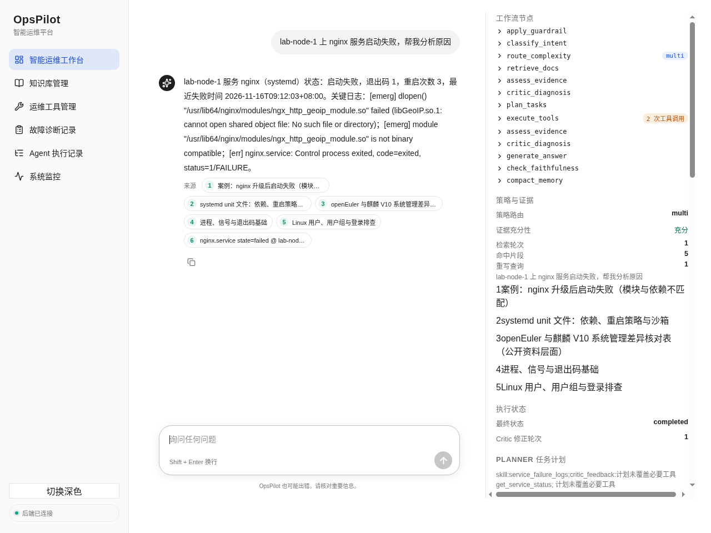
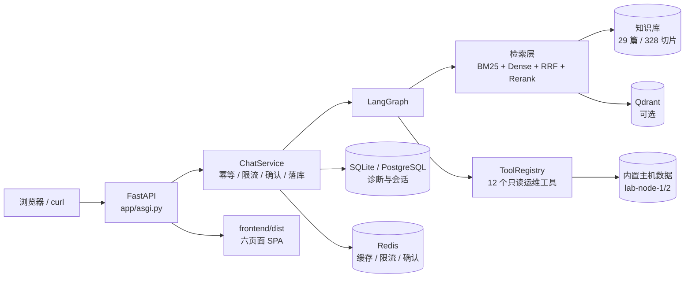

# OpsPilot

> 基于 RAG 与 Agent 的国产操作系统智能运维平台。面向 Linux、openEuler 与麒麟 V10，把知识检索、工具取证、证据评估、诊断检查和人工确认串成一条可追溯的运维诊断链路。



## 1. 项目简介与应用场景

通用大模型能解释“什么是 systemd”，但无法回答“这台机器上的 nginx 为什么起不来”。OpsPilot 的差异在于把两类证据放进同一条诊断链路：

- **知识证据**：29 篇运维手册、7 个知识域、328 个 BM25 切片，覆盖 Linux 基础、RPM、systemd、Supervisor、ELK、网络磁盘、安全权限和国产操作系统差异。
- **现场证据**：通过能力化工具查询主机、服务、日志、软件包和 Elasticsearch 日志，而不是让模型自由生成 Shell。

典型场景：

| 场景 | 系统会做什么 |
|:---|:---|
| nginx 启动失败 | 检索 systemd/nginx 知识，调用 `get_service_status`、`get_service_logs`，结合日志给出诊断与引用 |
| RPM 依赖冲突 | 调用 `get_rpm_info`、`check_rpm_dependencies`，区分“包不存在”“参数缺失”和“依赖冲突” |
| Supervisor 频繁重启 | 查询托管程序、Supervisor 配置与进程日志，区分程序异常和重启策略问题 |
| Elasticsearch 大量 ERROR | 调用 ES 日志检索、错误聚合、Logstash Pipeline 状态，明确区分 ES 日志和本地 journal |
| 重启服务 | 返回待确认动作；用户确认后只执行一次 |

## 2. 核心功能

- **五路诊断策略**：`DIRECT` 直接回答、`SINGLE` 单跳检索、`MULTI` 多跳诊断、`AGENT` 工具取证、`REFUSE` 安全拒答。
- **Planner → Executor → Critic → 定向修正**：Planner 生成工具计划；Executor 执行并记录状态；Critic 检查计划覆盖、工具失败、证据类型、证据冲突和重复计划；不通过时最多修正 `MAX_CORRECTION_ROUNDS` 轮。
- **统一 Evidence / Citation**：知识片段和工具结果进入同一证据列表，最终答案同时引用知识库和工具证据。
- **RAG 检索**：BM25 + 向量召回 + RRF 融合 + 可选 Cross-Encoder 重排；支持 Qdrant，Qdrant 不可用时降级到进程内向量库。
- **运维工具**：12 个只读运维工具，加上知识检索、转人工和 2 个 MCP 辅助工具；写工具 `restart_service` 默认不注册。
- **安全控制**：主机白名单、参数 Schema 校验、Shell 片段拒绝、工具超时、写操作人工确认、Redis 不可用时确认存储直接拒绝。
- **六页面控制台**：工作台、知识库、工具管理、诊断记录、Agent 执行记录、系统监控。

## 3. 技术栈

| 层 | 选型 |
|:---|:---|
| 后端 | Python 3.11+、FastAPI、Pydantic v2、SQLAlchemy 2、Alembic |
| Agent | LangGraph、DeepSeek（可选） |
| 检索 | BM25、BGE-small 向量（可选）、RRF、Cross-Encoder（可选）、Qdrant |
| 存储 | SQLite / PostgreSQL、Redis（缓存、限流、确认存储） |
| 前端 | React 19、TypeScript、Vite、React Router、Vitest |
| 部署 | Docker 多阶段构建、Docker Compose 三套拓扑、Nginx 网关 |

## 4. 系统架构



请求链路的关键点：`ChatService` 只负责请求级关注点，不直接检索或执行工具；检索、规划、执行、Critic 和答案生成都在 LangGraph 节点内完成。

## 5. Agent 工作流程

```text
START
  → apply_guardrail
      ├─ REFUSE → refuse_answer → compact_memory → END
      └─ classify_intent → route_complexity
            ├─ DIRECT → generate_answer
            ├─ SINGLE / MULTI / AGENT → retrieve_docs
            └─ confirmed_action → plan_tasks

retrieve_docs → assess_evidence → critic_diagnosis
critic_diagnosis
  ├─ retrieve → retrieve_docs
  ├─ plan     → plan_tasks
  └─ accept   → generate_answer

plan_tasks
  ├─ 缺少必要参数 / 有待确认动作 → generate_answer
  └─ execute_tools → assess_evidence → critic_diagnosis

generate_answer → check_faithfulness → compact_memory → END
```

- `AGENT` 路径先检索知识，再执行工具，避免只拿现场数据、不引用户手册。
- `Critic` 位于答案生成之前，检查任务完成度和证据充分性；`check_faithfulness` 位于答案生成之后，检查答案忠实度，两者职责分开。
- 修正轮数由 `max_correction_rounds` 限制，默认 2；重复计划由 `plan_fingerprint` / `plan_history` 拦截。

## 6. RAG 知识检索流程

```text
knowledge/*.md + _manifest.json
  → 解析（Markdown 标题切分；可选 Unstructured）
  → 清洗与去重
  → 切片（标题、章节、chunk_index 保留）
  → 绑定 manifest 元数据（doc_id / category / source_type / source / system / version / updated_at）
  → Embedding（BGE-small；无权重时降级 hash）
  → Qdrant upsert（按 document_id 先删后写，避免旧切片残留）
  → BM25 索引
  → 用户问题：查询改写 → BM25 + 向量 → RRF → 可选 Cross-Encoder
  → 返回 chunk、文档标题、来源与适用版本
```

检索结果必须可追溯到原始文档：`document_id`、`chunk_id`、`title`、`source_type`、`source_url`、`system`、`applicable_version` 随证据一起返回。

## 7. 运维工具体系

| 类别 | 工具 |
|:---|:---|
| 主机与资源 | `get_system_info`、`get_cpu_memory`、`get_disk_usage` |
| systemd / 服务 | `get_service_status`、`get_service_logs` |
| RPM | `get_rpm_info`、`check_rpm_dependencies` |
| Supervisor | `list_supervisor_programs`、`get_supervisor_program_config` |
| ELK | `search_elasticsearch_logs`、`aggregate_error_logs`、`get_logstash_pipeline_status` |
| 支撑 | `search_knowledge`、`escalate_to_human`、`mcp_change_window`、`mcp_oncall_roster` |
| 写操作（默认关闭） | `restart_service`，需 `OPS_ENABLE_WRITE_TOOLS=true` 且人工确认 |

默认注册 16 个工具；开启写工具后是 17 个。工具清单以 `/api/v1/ops/tools` 的 `describe()` 返回为准，不以 README 为准。

工具数据位于 `app/ops/data/lab-node-1.json`、`lab-node-2.json`。同一主机、同一服务的状态、日志、Supervisor 配置、RPM 依赖和 ES 日志相互关联。

## 8. 安全控制与人工确认

- **工具能力化**：模型只能调用 `get_service_status(...)` 这类结构化能力，不能生成任意 Shell。
- **两层写开关**：`OPS_ENABLE_WRITE_TOOLS=false` 时 `restart_service` 不注册；即使开启，执行层仍要求一次性确认。
- **确认存储**：`PENDING_STORE_BACKEND=auto` 时，Redis 可用则写入 Redis；Redis 不可用时返回 `CONFIRMATION_STORE_UNAVAILABLE` / HTTP 503，不降级到进程内字典。
- **主机白名单**：`OPS_ALLOWED_HOSTS` 之外的主机直接拒绝。
- **超时与失败**：`Tool.run()` 用 `asyncio.wait_for` 强制超时；工具失败会进入 `tool_trace`，不会被标成成功。
- **知识来源诚实**：`knowledge/_manifest.json` 只允许 `self_written` / `public_summary`，不标注为厂商官方内部文档。

## 9. 项目目录结构

```text
app/
  api/routes/        chat / ops / diagnoses / admin / health
  agents/            LangGraph 图、状态、节点（planner/executor/critic/faithfulness）
  retrieval/         解析、清洗、切片、BM25、向量、RRF、RRF 缓存、Qdrant
  ops/               主机夹具、后端抽象、目标校验
  tools/             工具注册表、只读运维工具、MCP 代理
  services/          ChatService、容器装配、确认存储
  repositories/      SQLAlchemy 模型、诊断/会话/幂等仓储
  providers/         DeepSeek / Embedding / Cross-Encoder / 离线模式
  guardrails/        安全护栏、边界检查、忠实度检查
  prompts/           运维提示词
knowledge/           29 篇 Markdown + _manifest.json
frontend/            React + TypeScript 六页面控制台
alembic/             数据库迁移
docs/                当前文档、阶段报告、历史归档
tests/               unit / integration / e2e
```

## 10. 环境要求

- Python **3.11+**（当前云主机验证环境为 3.12）
- Node.js **20.19+ 或 22.12+**
- 可选：Docker 24+ 与 Docker Compose v2
- 可选：Redis 7、Qdrant 1.12、PostgreSQL 16
- 可选：`sentence-transformers` 与模型权重（`.[rerank]`）；不安装时检索退化为 BM25 + hash 向量
- 可选：`unstructured` 与系统包（`.[docs]`）；不安装时 Markdown 走标题切分

## 11. 安装与启动

### 11.1 本地快速启动（SQLite + 进程内检索）

```bash
python3 -m venv .venv
. .venv/bin/activate
pip install -e ".[dev]"

cp .env.example .env
# 按实际部署核对工具后端与写工具开关
uvicorn app.asgi:app --reload --port 8000
```

另开终端构建并访问前端：

```bash
cd frontend
npm install
npm run build
# FastAPI 会自动在 http://127.0.0.1:8000 提供 frontend/dist
```

开发模式也可以：

```bash
cd frontend
npm run dev     # http://127.0.0.1:5173，/api 代理到 8000
```

### 11.2 启用真实 Redis / Qdrant（可选）

```bash
export REDIS_URL=redis://127.0.0.1:6379/0
export QDRANT_URL=http://127.0.0.1:6333
export QDRANT_COLLECTION=ops_knowledge
export PENDING_STORE_BACKEND=auto
uvicorn app.asgi:app --host 127.0.0.1 --port 8000
```

启动时会自动建集合并按 `document_id` 先删后写；同一份知识重复启动不会产生重复向量。

### 11.3 Docker Compose

```bash
# 默认演示：单 API + SQLite + 进程内检索
docker compose up --build -d

# 单机：PostgreSQL + Redis + API
export POSTGRES_PASSWORD='change-this-password'
docker compose -f docker-compose.single.yml up --build -d

# 多实例：PostgreSQL + Redis + Qdrant + 双 API + Nginx
docker compose -f docker-compose.multi.yml up --build -d
```

访问 `http://127.0.0.1:8000`。默认演示数据卷为 `opspilot-data`，单机为 `postgres-data`，多实例为 `postgres-data` + `qdrant-data`。

## 12. 核心功能演示

完整演示脚本见 [docs/21-demo-script.md](docs/21-demo-script.md)。最短路径：

```bash
# 1. 健康与能力
curl -s localhost:8000/api/v1/health
curl -s localhost:8000/api/v1/ready
curl -s localhost:8000/api/v1/capabilities

# 2. nginx 启动失败
curl -s localhost:8000/api/v1/chat \
  -H 'content-type: application/json' \
  -d '{"message":"lab-node-1 上 nginx 服务启动失败，帮我分析原因","user_id":"u_demo"}'

# 3. RPM 依赖冲突
curl -s localhost:8000/api/v1/chat \
  -H 'content-type: application/json' \
  -d '{"message":"lab-node-1 安装 nginx 相关 RPM 时出现依赖冲突，帮我分析原因","user_id":"u_demo"}'

# 4. Supervisor 频繁退出
curl -s localhost:8000/api/v1/chat \
  -H 'content-type: application/json' \
  -d '{"message":"lab-node-1 上 app-worker 被 Supervisor 反复重启，帮我分析原因","user_id":"u_demo"}'

# 5. Elasticsearch 错误日志
curl -s localhost:8000/api/v1/chat \
  -H 'content-type: application/json' \
  -d '{"message":"lab-node-1 最近应用日志出现大量 ERROR，帮我分析原因","user_id":"u_demo"}'
```

## 13. 六页面控制台

| 路由 | 页面 | 主要接口 |
|:---|:---|:---|
| `/workbench` | 智能运维工作台 | `POST /api/v1/chat`、`POST /api/v1/chat/stream` |
| `/knowledge` | 知识库管理 | `GET /api/v1/ops/knowledge/documents`、`.../{document_id}` |
| `/tools` | 运维工具管理 | `GET /api/v1/ops/tools` |
| `/diagnoses` | 故障诊断记录 | `GET /api/v1/diagnoses`、`.../{trace_id}` |
| `/traces` | Agent 执行记录 | 同上，展示计划、Critic、工具轨迹 |
| `/monitoring` | 系统监控 | `GET /api/v1/ops/hosts`、`/ops/hosts/{id}/overview`、`/capabilities` |

## 14. 测试方式

```bash
.venv/bin/python -m pytest -q
.venv/bin/python -m ruff check app tests eval scripts
.venv/bin/python -m mypy app

cd frontend
npm test -- --run
npm run build
```

当前实测：后端 **259 passed**（1 条 LangGraph 依赖弃用警告）、Ruff 全绿、Mypy **128 个文件**无问题；前端 **3 passed**，生产构建 **2182 modules**、JS 465.33 kB、CSS 23.19 kB。测试覆盖工具 Schema、超时、白名单、写开关、确认一次性、证据充分性、统一的 Evidence/Citation、图拓扑、检索缓存、Critic 和四类运维场景。

## 15. 工程说明

- 运维工具通过统一适配层访问数据，演示环境使用仓库内置的本地示例数据。
- `restart_service` 默认不注册，按需开启并经过人工确认。
- SSE 采用答案生成后分片推送。

## 16. 文档索引

| 文档 | 内容 |
|:---|:---|
| [03 · 系统架构](docs/03-architecture.md) | 当前拓扑、节点职责、证据流 |
| [06 · API 参考](docs/06-api-reference.md) | 请求/响应字段、SSE、错误码 |
| [20 · 部署与运维](docs/20-deployment-and-operations.md) | 三种部署拓扑、环境变量、排障 |
| [21 · 演示脚本](docs/21-demo-script.md) | 完整演示流程与实际结果 |
| [22 · 数据库设计](docs/22-database-design.md) | 表结构、诊断落库、迁移 |
| [23 · 工具与数据](docs/23-tools-and-data.md) | 工具清单、参数、数据关联 |
| [24 · 知识库流水线](docs/24-knowledge-pipeline.md) | 解析、切片、入库、检索、验证 |

历史教学文档已归档到 `docs/archive/legacy-ecommerce/`，不再作为当前行为说明。

## 17. 后续规划

1. 统一验收、打包检查与演示复核。
2. 容器部署与多实例编排完善。
3. 知识库上传、删除与增量索引 API。
4. 主机采集适配器与更细的权限模型。
5. 逐节点轨迹落库与诊断记录分页。

## License

MIT License。Copyright (c) 2026 qinghuan0606-star。
