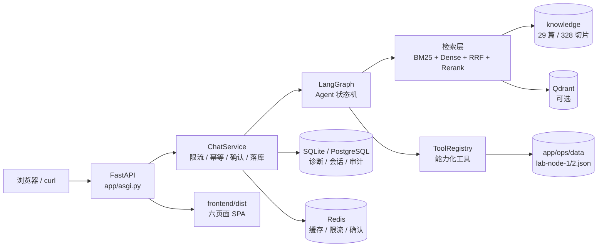
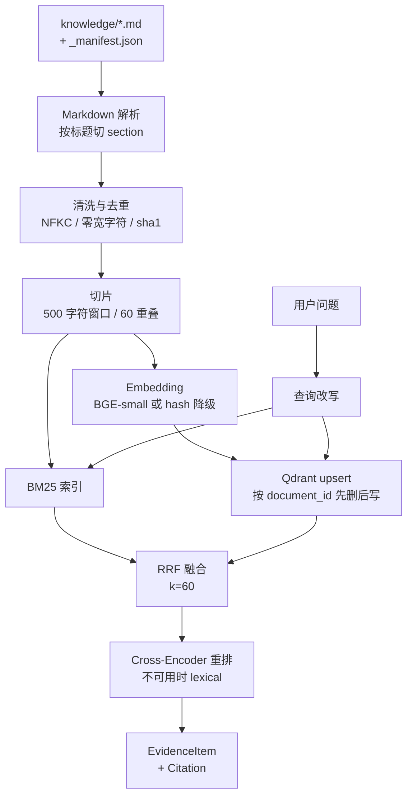
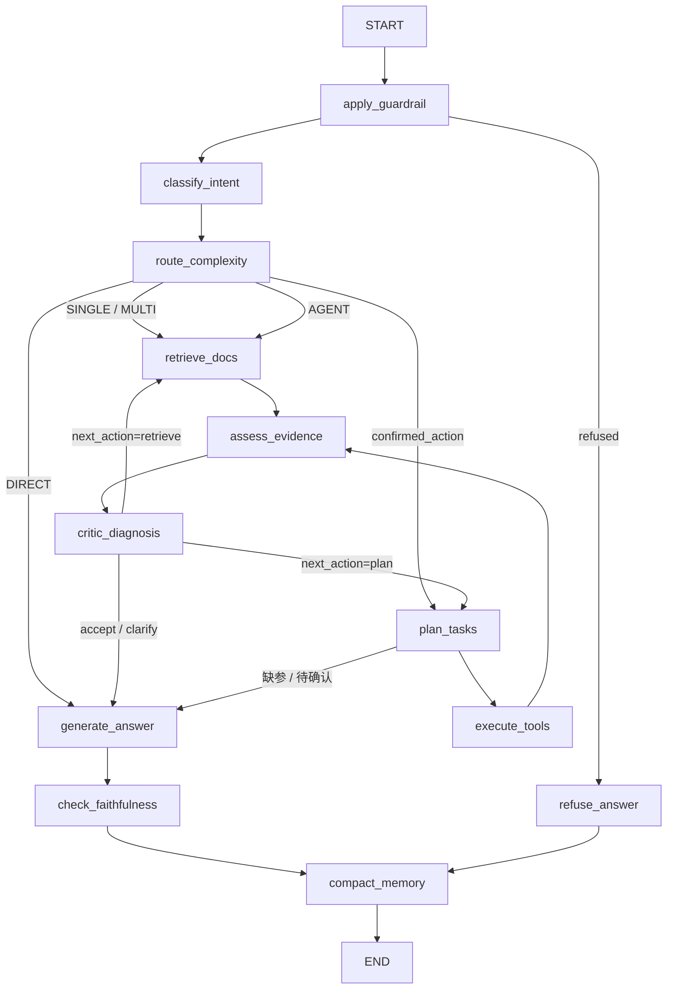
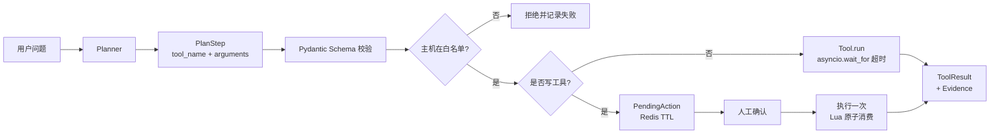
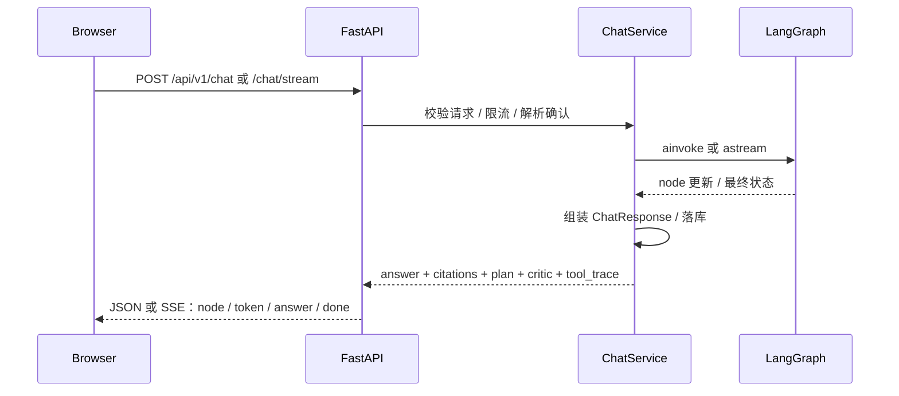
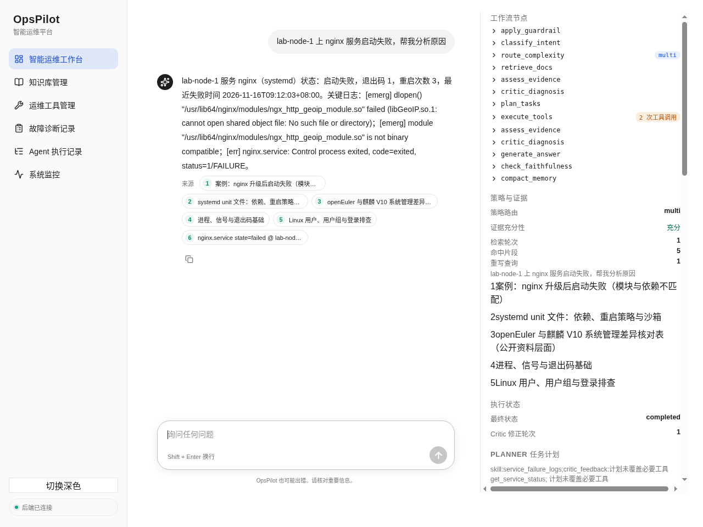

# 30 · 项目整体介绍与架构

> 本文面向项目讲解，描述当前仓库中的实现结构。

## 1. 项目最终简介（150～200 字）

OpsPilot 是面向 Linux、openEuler 与麒麟 V10 的运维平台，把“知识怎么说”和“机器上发生了什么”放进可追溯链路。FastAPI 提供接口，LangGraph 编排意图识别、知识检索、任务规划、工具执行与检查；RAG 用 BM25、Dense、RRF 和可选重排召回手册；工具侧通过能力化工具查询服务、日志、RPM 与 ELK。答案引用知识和工具证据，写操作须人工确认。

> 字数约 190 字，可作为项目摘要或介绍开场。若投递岗位偏 Java 后端，可把“FastAPI”替换为“后端服务”，其余技术事实不变。

## 2. 项目背景与应用场景

通用大模型能解释“systemd 是什么”，但无法回答“这台机器上的 nginx 为什么起不来”。真实运维诊断需要两类信息同时到位：

- **知识依据**：服务管理、RPM 依赖、日志排查、国产操作系统差异等手册和案例。
- **现场证据**：目标主机上的服务状态、退出码、日志、软件包版本、Supervisor 配置、Elasticsearch 错误日志。

OpsPilot 把这两类信息统一成可引用的证据，再交给 Agent 做诊断，避免模型只凭常识编答案。典型场景包括：

| 场景 | 系统要做的事 |
|:---|:---|
| nginx 启动失败 | 查 systemd 状态、退出码、journal 日志，结合 nginx/systemd 知识定位 `libGeoIP.so.1` 缺失与模块 ABI 冲突 |
| RPM 依赖冲突 | 查包版本、依赖关系，区分“包不存在”“参数缺失”“已安装但依赖不满足” |
| Supervisor 频繁退出 | 查托管程序状态、退出次数、日志与 `autorestart/startsecs/startretries`，区分应用崩溃和重启策略问题 |
| Elasticsearch 大量 ERROR | 查 ES 日志、按错误类型聚合、查 Logstash Pipeline 状态，并明确不退化成本地 journal |
| 重启服务 | 生成待确认动作，人工确认后只执行一次 |

## 3. 解决的核心问题

1. **知识与现场脱节**：答案只有“通常怎么做”，没有“这台机器实际是什么状态”。
2. **诊断不可追溯**：模型回答没有文档来源和工具 locator，无法复核。
3. **工具调用不安全**：如果让模型拼 Shell，容易越权、误操作、参数注入。
4. **一次性诊断容易漏步**：没有计划、没有检查、没有修正，缺少工具就直接给结论。
5. **写操作重复执行**：用户双击确认或多实例并发时，重启可能被执行多次。

对应的设计是：混合检索、统一 Evidence/Citation、能力化工具、Planner-Executor-Critic、Redis 一次性确认。

## 4. 核心功能

- **五路诊断策略**：`DIRECT` 直接回答、`SINGLE` 单跳检索、`MULTI` 多跳诊断、`AGENT` 工具取证、`REFUSE` 安全拒答。
- **Planner → Executor → Critic → 定向修正**：Planner 生成最多 6 步工具计划；Executor 执行并记录状态；Critic 检查计划覆盖、工具失败、证据类型、证据冲突和重复计划；不通过时在 `MAX_CORRECTION_ROUNDS` 内补充检索或重规划。
- **统一证据**：知识片段和工具结果都进入 `EvidenceItem`，最终答案从证据派生 `Citation`。
- **RAG 检索**：BM25 + Dense 向量 + RRF（`k=60`）+ 可选 Cross-Encoder；支持 Qdrant，Qdrant 不可用时降级到进程内向量库。
- **运维工具**：默认 16 个，开启写工具后 17 个；覆盖主机资源、systemd、RPM、Supervisor、ELK 和知识检索。
- **安全控制**：主机白名单、Pydantic Schema、shell 片段拒绝、工具超时、写工具开关、人工确认、Redis 不可用直接拒绝。
- **六页面控制台**：工作台、知识库、工具管理、诊断记录、Agent 执行记录、系统监控。

## 5. 技术栈

| 层 | 实际选型 |
|:---|:---|
| 后端 | Python 3.11+、FastAPI、Pydantic v2、SQLAlchemy 2、Alembic |
| Agent | LangGraph、DeepSeek（可选） |
| 检索 | BM25、BGE-small 向量（可选）、RRF、Cross-Encoder（可选）、Qdrant |
| 存储 | SQLite / PostgreSQL、Redis（检索缓存、限流、确认存储） |
| 前端 | React 19、TypeScript、Vite、React Router、Vitest |
| 部署 | Docker 多阶段构建、三套 Docker Compose、Nginx 网关 |

## 6. 整体系统架构

关键边界：`ChatService` 只处理请求级关注点（限流、确认解析、落库、trace_id），不直接检索、不直接执行工具；检索、规划、执行、Critic 和答案生成都在 LangGraph 节点内完成。工具层是能力接口（`service_status(...)`、`service_logs(...)`），没有 `run(command)`。

## 7. RAG 检索链路

要点：

- 切片保留 `document_id`、`chunk_id`、`section`、`title`、`category`、`source_type`、`system`、`applicable_version`。
- `chunk_id = <document_id>_<index:02d>`，引用可定位到原文。
- 启动时按 `document_id` 先删后写，避免重复入库留下旧切片。
- 检索缓存键是 `query + top_k`，只缓存知识检索，不缓存工具结果，避免把过期服务状态当成现场证据。

## 8. Agent 执行链路

- `AGENT` 路径先检索知识，再执行工具，保证答案既有手册依据，也有现场证据。
- `Critic` 在答案生成之前，负责“任务是否完成、证据是否够”；`check_faithfulness` 在答案生成之后，负责“答案是否超出证据”。两者职责分开。
- 修正轮数默认 2，`plan_fingerprint` / `plan_history` 拦截重复计划；轮数用尽后不再请求新 hop，而是在答案中说明证据不足。
- 缺少服务名或 RPM 包名时，Planner 返回澄清，不猜目标。

## 9. 工具调用与安全控制链路

安全边界：

- 模型只能填结构化参数，不能生成任意命令；日期、路径、关键词、服务名都做 shell 片段拒绝。
- `OPS_ENABLE_WRITE_TOOLS=false` 时 `restart_service` 不注册；开启后仍需确认。
- 确认动作绑定 `session_id + user_id`，Redis Lua 原子 check-and-delete，消费后写 `used` 标记；重复提交 409。
- Redis 不可用时确认存储返回 503，不降级到进程内 dict。
- 工具失败会保留 `success=false` / `status=error|timeout|fallback`，不会把 fallback 标成真实成功。

## 10. 前后端交互关系

- 六个页面：`/workbench`、`/knowledge`、`/tools`、`/diagnoses`、`/traces`、`/monitoring`。
- 工作台消费 `node` 事件展示真实节点进度，消费 `answer` 事件里的 `tool_trace`、`evidence_gaps`、`retrieval_detail`。
- `token` 事件按 48 字符切片推送答案内容。
- 工具目录读公开只读 `/api/v1/ops/tools`；`/api/v1/admin/tools` 仍要求 Admin Token。

> 工作台实际截图：节点链、Planner 计划、工具轨迹、Critic 结果和来源引用都在同一页展示。

## 11. 代码地图

| 模块 | 位置 | 作用 |
|:---|:---|:---|
| API | `app/api/routes/` | chat / ops / diagnoses / admin / health |
| Graph | `app/agents/graph.py` | 节点与条件边 |
| State | `app/agents/state.py` | AgentState 字段 |
| Nodes | `app/agents/nodes/` | planner / executor / critic / retrieval / generate / faithfulness |
| RAG | `app/retrieval/` | 解析、切片、BM25、向量、RRF、Qdrant、缓存 |
| Tools | `app/tools/` | 注册表、工具基类、运维工具、MCP 代理 |
| 数据 | `app/ops/data/` | `lab-node-1.json`、`lab-node-2.json` |
| Service | `app/services/` | ChatService、容器装配、确认存储 |
| DB | `app/repositories/` | SQLAlchemy 模型与诊断/会话/幂等仓储 |
| Frontend | `frontend/src/` | 六页面与 API 客户端 |
